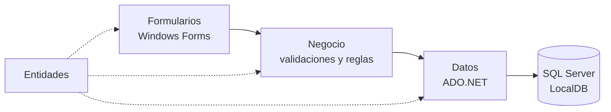
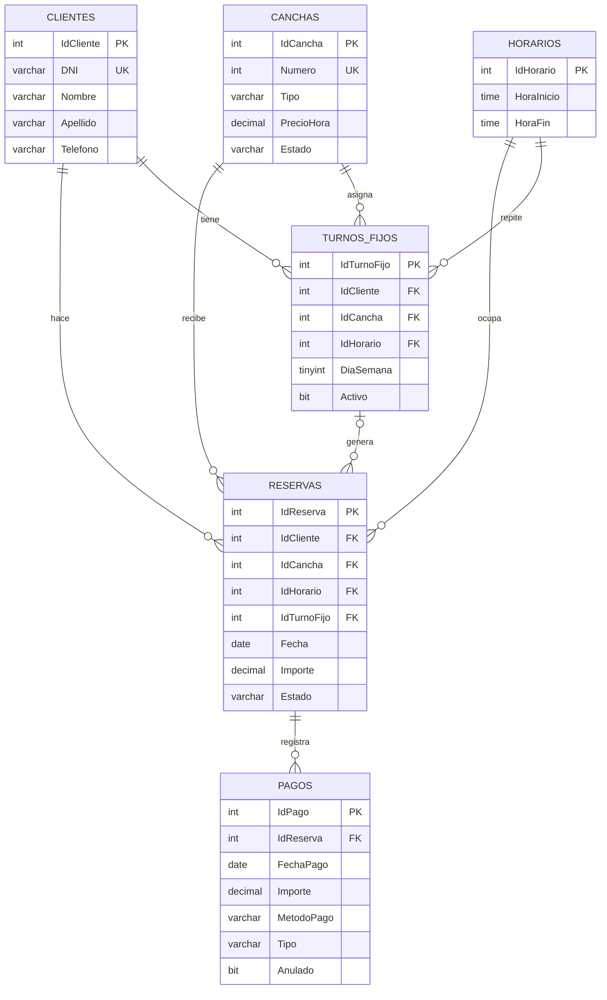

<div align="center">

# ⚽ Gestión de Canchas de Fútbol

**Aplicación de escritorio para administrar un complejo de canchas**: clientes, reservas, turnos
fijos, señas, pagos y devoluciones.


[](https://github.com/FedericoViceconte/gestioncanchas/actions/workflows/ci.yml)

</div>

## Índice

- [Sobre el proyecto](#sobre-el-proyecto)
- [Funciones](#funciones)
- [Reglas de negocio](#reglas-de-negocio)
- [Arquitectura](#arquitectura)
- [Modelo de datos](#modelo-de-datos)
- [Puesta en marcha](#puesta-en-marcha)
- [Pruebas](#pruebas)
- [Estructura del proyecto](#estructura-del-proyecto)
- [Licencia](#licencia)

## Sobre el proyecto

Proyecto final de **Programación Orientada a Objetos**. Es una aplicación Windows Forms en C#
(.NET 10) con base de datos SQL Server LocalDB, organizada en capas: entidades, acceso a datos,
reglas de negocio y formularios.

Cubre el trabajo diario de un complejo de fútbol: registrar clientes y canchas, tomar reservas con
seña, consultar la disponibilidad del día, cobrar, devolver dinero y llevar la deuda de cada cliente.

## Funciones

| Módulo | Qué permite |
| --- | --- |
| **Resumen del día** | Turnos de hoy y clientes con deuda, al abrir la aplicación |
| **Clientes** | Alta, edición, baja y búsqueda por DNI, nombre, apellido o teléfono |
| **Canchas** | Número, tipo, precio por hora y estado (disponible o en mantenimiento) |
| **Horarios** | Franjas horarias sin superposición; por defecto, de 8 a 23 h |
| **Reservas** | Alta con seña, modificación, cancelación y marca de ausente |
| **Disponibilidad** | Grilla de canchas por horario para cualquier fecha; doble clic en un turno libre para reservarlo |
| **Turnos fijos** | Reservas semanales para un mismo cliente, cancha, día y horario, de 1 a 26 semanas |
| **Pagos** | Pagos en efectivo, transferencia o tarjeta, anulaciones y devoluciones |
| **Consultas** | Reservas por fecha, DNI, cancha, estado o solo con saldo; pagos por DNI y rango de fechas |

## Reglas de negocio

Las reglas se validan en la capa de **Negocio** antes de llegar a la base, y las más importantes
también están garantizadas por **restricciones de SQL Server**.

- **Sin reservas duplicadas:** una cancha no puede tener dos reservas en la misma fecha y horario.
  Lo asegura un índice único filtrado que ignora las reservas canceladas, además de la validación
  en `ReservaNegocio`.
- **Seña mínima del 15 %** del importe, que tampoco puede superar el total de la reserva.
- **Estados de reserva:** Pendiente, Señado, Pagado, Cancelada y Ausente. Una reserva cancelada
  libera el turno y no genera deuda.
- **No se reserva en el pasado**, ni en un horario de hoy que ya empezó.
- **Turnos fijos:** se generan semana a semana; las fechas que ya están ocupadas se omiten y se
  informan.
- **Pagos y devoluciones:** los pagos se anulan en lugar de borrarse, y solo se puede devolver
  dinero de una reserva que tiene algo cobrado.
- **Deuda del cliente:** se calcula con las vistas `vw_SaldoReservas` y `vw_DeudaClientes`, sin
  contar reservas canceladas, ausentes ni pendientes de fechas futuras.
- **Integridad:** DNI único de 7 u 8 dígitos y operaciones de varios pasos (reserva con seña, pago
  con cambio de estado, turnos fijos) dentro de **transacciones**.

## Arquitectura



| Capa | Responsabilidad |
| --- | --- |
| `Entidades` | Clases que representan las tablas y los datos que muestran las grillas |
| `Datos` | Acceso a SQL Server con consultas parametrizadas (una clase por tabla) |
| `Negocio` | Validaciones y reglas; los errores de usuario se informan con `ValidacionException` |
| `Formularios` | Pantallas de Windows Forms, grillas y mensajes |

## Modelo de datos



## Puesta en marcha

**Requisitos:** Windows y Visual Studio 2026 con estas cargas de trabajo:

- Desarrollo de escritorio de .NET
- Almacenamiento y procesamiento de datos (instala SQL Server LocalDB)

**Pasos:**

1. **Crear la base:** en Visual Studio, abrí *Ver › Explorador de objetos de SQL Server*, conectate
   a `(localdb)\MSSQLLocalDB`, abrí una nueva consulta y ejecutá
   `GestionCanchas/Scripts/GestionCanchas.sql`. El script crea la base con datos de prueba.
2. Abrí `GestionCanchas.slnx`.
3. Ejecutá con **F5**. El paquete NuGet `Microsoft.Data.SqlClient` se restaura solo.

Si tu instancia de LocalDB tiene otro nombre, cambiá la cadena de conexión en `Datos/Conexion.cs`.

## Pruebas

El proyecto `GestionCanchas.Tests` tiene **34 pruebas con xUnit** sobre las reglas de negocio:
validación del DNI y de los datos de clientes, canchas y horarios, la seña mínima del 15 %, el
cálculo del importe y los métodos de pago. Todas se resuelven antes de llegar a la base, así que
no necesitan SQL Server.

```sh
dotnet test GestionCanchas.slnx
```

GitHub Actions compila la solución y corre las pruebas en Windows en cada cambio.

## Estructura del proyecto

```text
GestionCanchas/
├── Entidades/     # Cliente, Cancha, Horario, Reserva, TurnoFijo, Pago y vistas de detalle
├── Datos/         # acceso a SQL Server con ADO.NET y transacciones
├── Negocio/       # reglas y validaciones por módulo
├── Formularios/   # pantallas, grillas reutilizables y mensajes
├── Scripts/       # GestionCanchas.sql: tablas, restricciones, vistas y datos de prueba
└── Program.cs
GestionCanchas.Tests/   # pruebas de las reglas de negocio con xUnit
```

## Licencia

© 2026 Federico Viceconte. Todos los derechos reservados: ver [COPYRIGHT.txt](COPYRIGHT.txt). Las bibliotecas de terceros conservan sus licencias, detalladas en [LICENCIAS.txt](LICENCIAS.txt).
