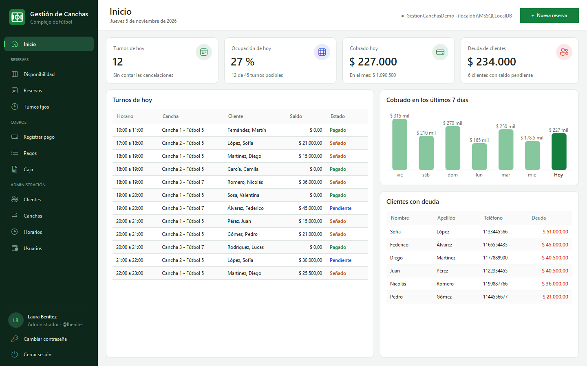
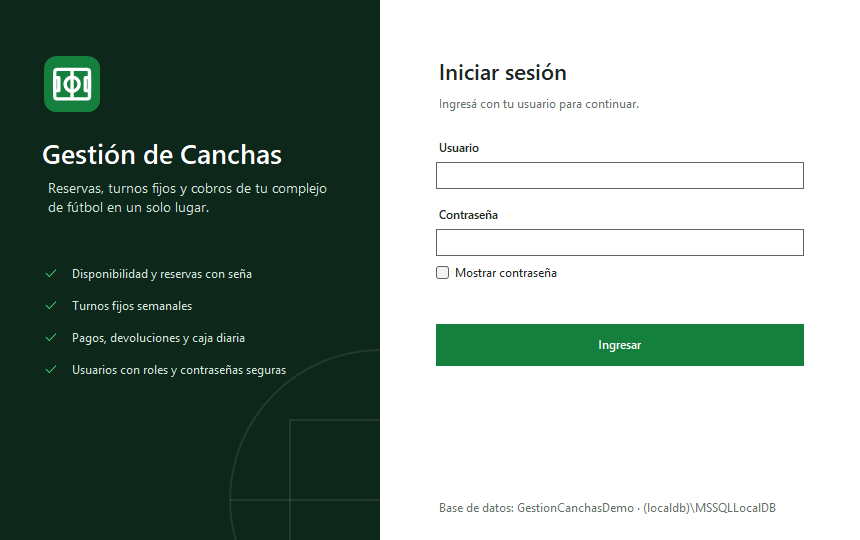
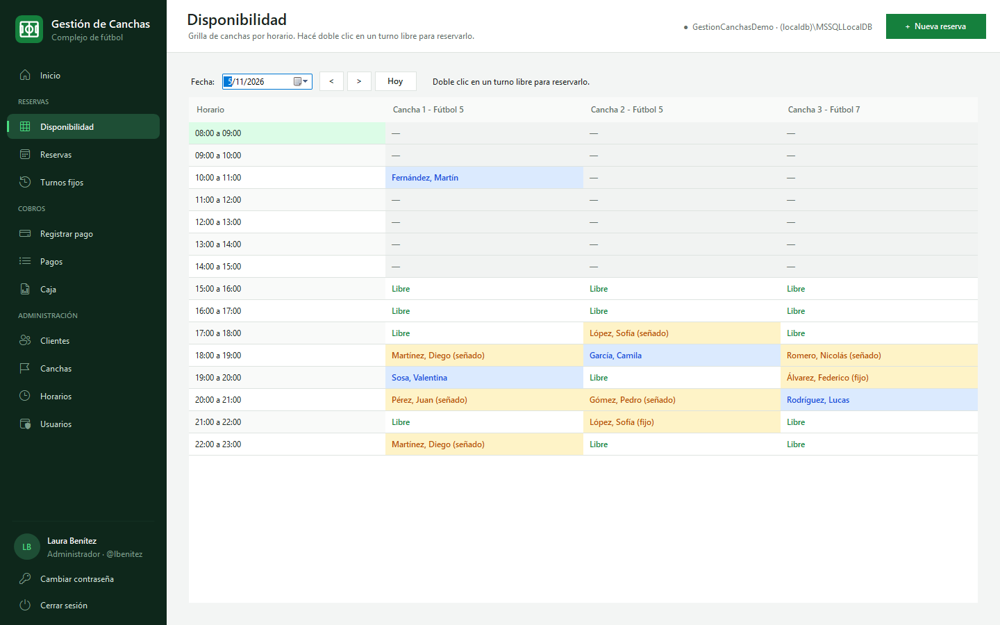
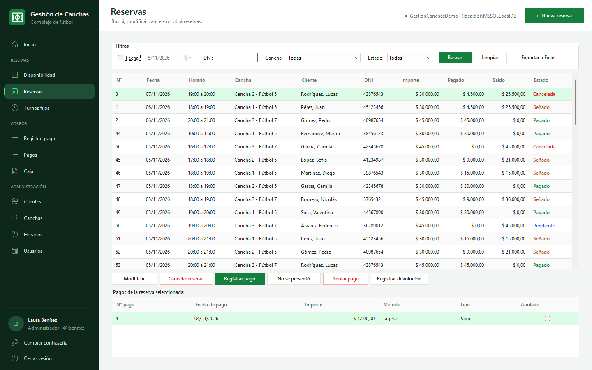
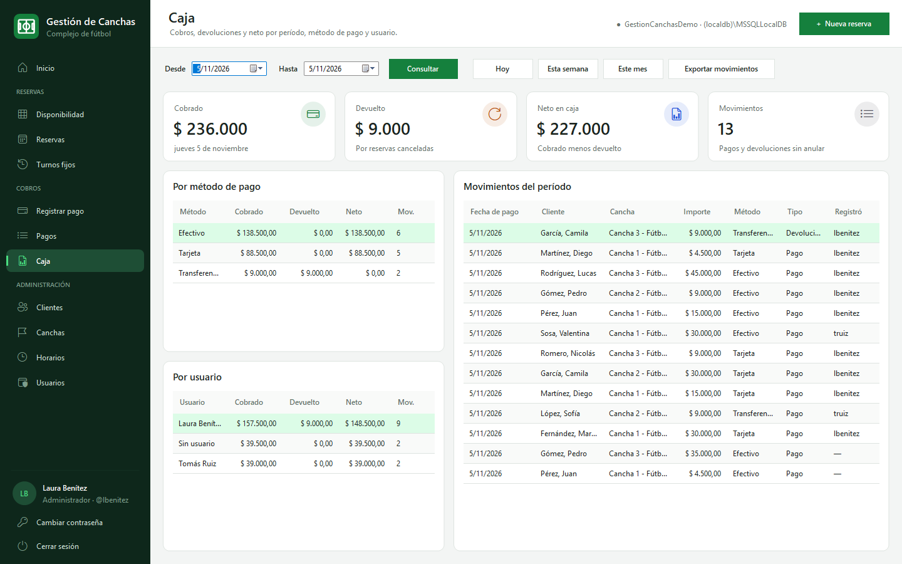
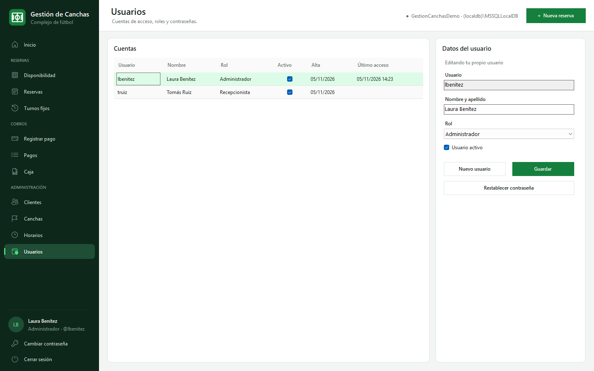
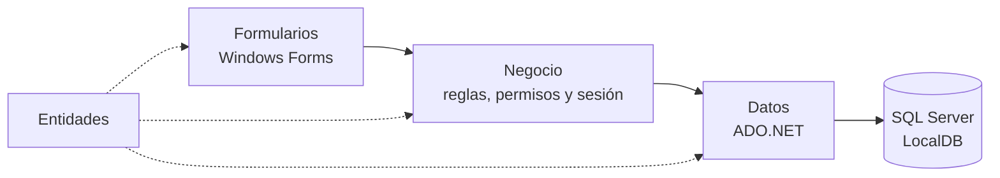
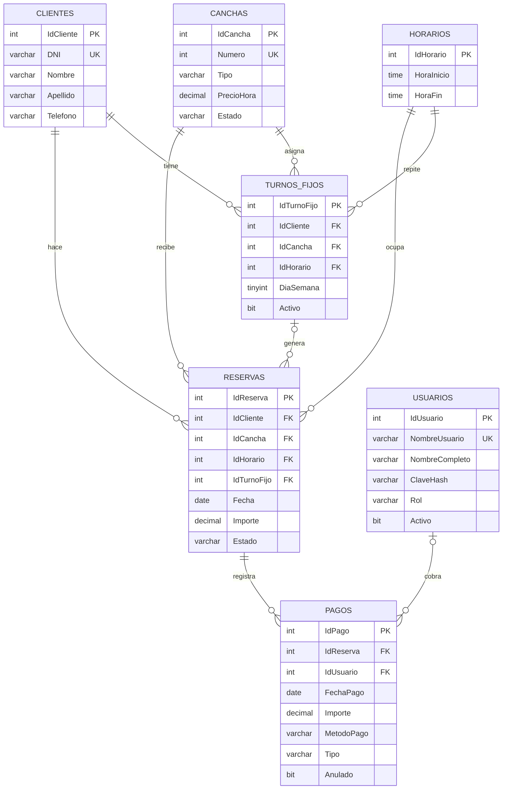

<div align="center">


# Gestión de Canchas

**Aplicación de escritorio para administrar un complejo de fútbol**: reservas con seña, turnos fijos,
cobros, caja diaria y usuarios con roles.


[](https://github.com/FedericoViceconte/gestioncanchas/actions/workflows/ci.yml)
[](https://github.com/FedericoViceconte/gestioncanchas/releases/latest)

### [Descargar para Windows](https://github.com/FedericoViceconte/gestioncanchas/releases/latest)



</div>

> **In English:** Windows desktop app (C#, .NET 10, Windows Forms, SQL Server) to run a football pitch rental
> business: bookings with deposits, recurring weekly slots, payments and refunds, cash reports and user accounts
> with roles. Layered architecture, ADO.NET with parameterized queries, PBKDF2 password hashing, and 72 automated
> tests (unit and SQL Server LocalDB integration) running on GitHub Actions. A self-contained `.exe` is published
> on every release.

## Índice

- [Sobre el proyecto](#sobre-el-proyecto)
- [Capturas](#capturas)
- [Funciones](#funciones)
- [Usuarios y permisos](#usuarios-y-permisos)
- [Reglas de negocio](#reglas-de-negocio)
- [Seguridad](#seguridad)
- [Arquitectura](#arquitectura)
- [Modelo de datos](#modelo-de-datos)
- [Descargar y usar](#descargar-y-usar)
- [Desarrollo](#desarrollo)
- [Pruebas](#pruebas)
- [Estructura del proyecto](#estructura-del-proyecto)
- [Licencia](#licencia)

## Sobre el proyecto

Nació como proyecto final de **Programación Orientada a Objetos**: una aplicación Windows Forms en C# (.NET 10)
con SQL Server, organizada en capas de entidades, acceso a datos, reglas de negocio y formularios.

Cubre el trabajo diario de un complejo de fútbol: registrar clientes y canchas, tomar reservas con seña, ver la
disponibilidad del día, cobrar, devolver dinero, cerrar la caja y saber cuánto debe cada cliente.

La versión 2 suma inicio de sesión con roles, un panel de inicio con indicadores, la caja por período,
exportación a Excel, una interfaz renovada y la creación automática de la base de datos.

## Capturas

| Inicio de sesión | Disponibilidad |
| --- | --- |
|  |  |
| **Reservas** | **Caja** |
|  |  |
| **Usuarios** | |
|  | |

## Funciones

| Módulo | Qué permite |
| --- | --- |
| **Inicio** | Turnos y ocupación del día, cobrado hoy y en el mes, deuda total, gráfico de los últimos 7 días y clientes con deuda |
| **Disponibilidad** | Grilla de canchas por horario para cualquier fecha; doble clic en un turno libre para reservarlo |
| **Reservas** | Alta con seña, modificación, cancelación, marca de ausente, pagos y devoluciones; filtros por fecha, DNI, cancha y estado |
| **Turnos fijos** | Reservas semanales para un mismo cliente, cancha, día y horario, de 1 a 26 semanas |
| **Pagos** | Cobro de señas y saldos en efectivo, transferencia o tarjeta, con el usuario que registró cada uno |
| **Caja** | Cobrado, devuelto y neto de un día, una semana, un mes o cualquier período, por método de pago y por usuario |
| **Clientes** | Alta, edición, baja y búsqueda por DNI, nombre, apellido o teléfono, con la deuda de cada uno |
| **Canchas y horarios** | Número, tipo, precio por hora y estado de cada cancha; franjas horarias sin superposición |
| **Usuarios** | Cuentas de acceso, roles, activación y restablecimiento de contraseñas |
| **Exportar a Excel** | Reservas, pagos, clientes y movimientos de caja a CSV, con acentos y columnas correctas en Excel |

Atajos: **Ctrl+N** abre una reserva nueva desde cualquier pantalla y **F5** actualiza la pantalla actual.

## Usuarios y permisos

En el primer inicio, la aplicación pide crear la cuenta de administrador. Desde **Usuarios**, el administrador
crea las cuentas de recepción.

| Acción | Administrador | Recepcionista |
| --- | :---: | :---: |
| Reservas, disponibilidad, turnos fijos y clientes | ✓ | ✓ |
| Cobrar pagos y consultar la caja | ✓ | ✓ |
| Anular pagos y registrar devoluciones | ✓ | |
| Canchas, horarios y usuarios | ✓ | |

Los permisos se validan en la capa de negocio, no solo ocultando opciones del menú.

## Reglas de negocio

Las reglas se validan en la capa de **Negocio** antes de llegar a la base, y las más importantes
también están garantizadas por **restricciones de SQL Server**.

- **Sin reservas duplicadas:** una cancha no puede tener dos reservas en la misma fecha y horario.
  Lo asegura un índice único filtrado que ignora las reservas canceladas, además de la validación
  en `ReservaNegocio`.
- **Seña mínima del 15 %** del importe, que tampoco puede superar el total de la reserva.
- **Estados de reserva:** Pendiente, Señado, Pagado, Cancelada y Ausente. Una reserva cancelada
  libera el turno y no genera deuda.
- **No se reserva en el pasado**, ni en un horario de hoy que ya empezó.
- **Turnos fijos:** se generan semana a semana; las fechas que ya están ocupadas se omiten y se
  informan.
- **Pagos y devoluciones:** los pagos se anulan en lugar de borrarse, y solo se puede devolver
  dinero de una reserva cancelada que tiene algo cobrado.
- **Deuda del cliente:** se calcula con las vistas `vw_SaldoReservas` y `vw_DeudaClientes`, sin
  contar reservas canceladas, ausentes ni pendientes de fechas futuras.
- **Usuarios:** siempre queda al menos un administrador activo, y nadie puede quitarse su propio rol de
  administrador ni desactivar su usuario.
- **Integridad:** DNI único de 7 u 8 dígitos y operaciones de varios pasos (reserva con seña, pago
  con cambio de estado, turnos fijos) dentro de **transacciones**.

## Seguridad

- **Contraseñas con hash PBKDF2-HMAC-SHA256**, 600.000 iteraciones y una sal aleatoria por contraseña,
  comparadas en tiempo constante. Nunca se guardan ni se muestran en texto.
- **Bloqueo temporal:** después de 5 intentos fallidos, el usuario queda bloqueado un minuto.
- **Contraseñas razonables:** al menos 8 caracteres, con letras y números, y distintas del usuario.
- **Consultas parametrizadas** en todo el acceso a datos.
- **Exportación segura:** los valores que Excel interpretaría como fórmula se exportan como texto.

## Arquitectura



| Capa | Responsabilidad |
| --- | --- |
| `Entidades` | Clases que representan las tablas, los reportes y los datos que muestran las grillas |
| `Datos` | Acceso a SQL Server con consultas parametrizadas, creación de la base y actualizaciones del esquema |
| `Negocio` | Validaciones, reglas, permisos por rol, sesión y hash de contraseñas; los errores de usuario se informan con `ValidacionException` |
| `Formularios` | Pantallas de Windows Forms, tema visual, controles propios (tarjetas, gráfico, menú lateral) y exportación |

Al iniciar, la aplicación verifica la base: si no existe, ofrece crearla con datos de ejemplo
(`Scripts/GestionCanchas.sql`), y si existe le aplica las actualizaciones pendientes (`Scripts/Actualizaciones.sql`).

## Modelo de datos



## Descargar y usar

1. Instalá **SQL Server Express LocalDB** si no lo tenés: viene con Visual Studio o se descarga gratis de Microsoft.
2. Descargá el zip de la [última versión](https://github.com/FedericoViceconte/gestioncanchas/releases/latest),
   descomprimilo y abrí `GestionCanchas.exe`. No hace falta instalar .NET.
3. La primera vez, la aplicación crea la base `GestionCanchas` con canchas, horarios y clientes de ejemplo, y te
   pide crear la cuenta de administrador.

Para usar otro servidor, cambiá la cadena de conexión en `appsettings.json`, junto al ejecutable, o definí la
variable de entorno `GESTIONCANCHAS_CONEXION`, que tiene prioridad.

## Desarrollo

**Requisitos:** Windows, el SDK de .NET 10 y SQL Server LocalDB. Con Visual Studio 2026 alcanzan las cargas de
trabajo *Desarrollo de escritorio de .NET* y *Almacenamiento y procesamiento de datos*.

```sh
dotnet run --project GestionCanchas
```

También podés abrir `GestionCanchas.slnx` en Visual Studio y ejecutar con **F5**. Si preferís crear la base a
mano, ejecutá `GestionCanchas/Scripts/GestionCanchas.sql` sobre `(localdb)\MSSQLLocalDB`; la aplicación le
aplica las actualizaciones al iniciar.

Para publicar una versión, alcanza con subir una etiqueta: GitHub Actions corre las pruebas, genera el
ejecutable autocontenido y crea la versión con el zip.

```sh
git tag v2.0.0
git push origin v2.0.0
```

## Pruebas

El proyecto `GestionCanchas.Tests` tiene **72 pruebas con xUnit**:

- **Reglas de negocio** sin base de datos: DNI, clientes, canchas, horarios, seña mínima, importes, métodos de
  pago, hash de contraseñas, política de contraseñas, permisos y exportación a CSV.
- **Integración con SQL Server LocalDB**: crean una base `GestionCanchasPruebas` desde el script, prueban inicio de
  sesión, bloqueo por intentos, permisos por rol, reservas con seña, turnos duplicados, pagos, devoluciones y caja,
  y la borran al terminar.

```sh
dotnet test GestionCanchas.slnx
```

Sin LocalDB, podés correr solo las pruebas que no usan base:

```sh
dotnet test GestionCanchas.slnx --filter "Categoria!=BaseDeDatos"
```

GitHub Actions compila la solución y corre todas las pruebas, con LocalDB, en Windows en cada cambio.

## Estructura del proyecto

```text
GestionCanchas/
├── Entidades/     # Cliente, Cancha, Horario, Reserva, TurnoFijo, Pago, Usuario y reportes
├── Datos/         # conexión, creación y actualización de la base, acceso a SQL Server con ADO.NET
├── Negocio/       # reglas, permisos, sesión, hash de contraseñas y reportes
├── Formularios/   # pantallas, tema visual, controles propios, grillas y exportación
├── Recursos/      # ícono de la aplicación
├── Scripts/       # GestionCanchas.sql (esquema y datos de ejemplo) y Actualizaciones.sql
├── appsettings.json
└── Program.cs
GestionCanchas.Tests/   # pruebas de reglas de negocio y de integración con xUnit
docs/capturas/          # capturas del README
```

## Licencia

© 2026 Federico Viceconte. Todos los derechos reservados: ver [COPYRIGHT.txt](COPYRIGHT.txt). Las bibliotecas de terceros conservan sus licencias, detalladas en [LICENCIAS.txt](LICENCIAS.txt).
